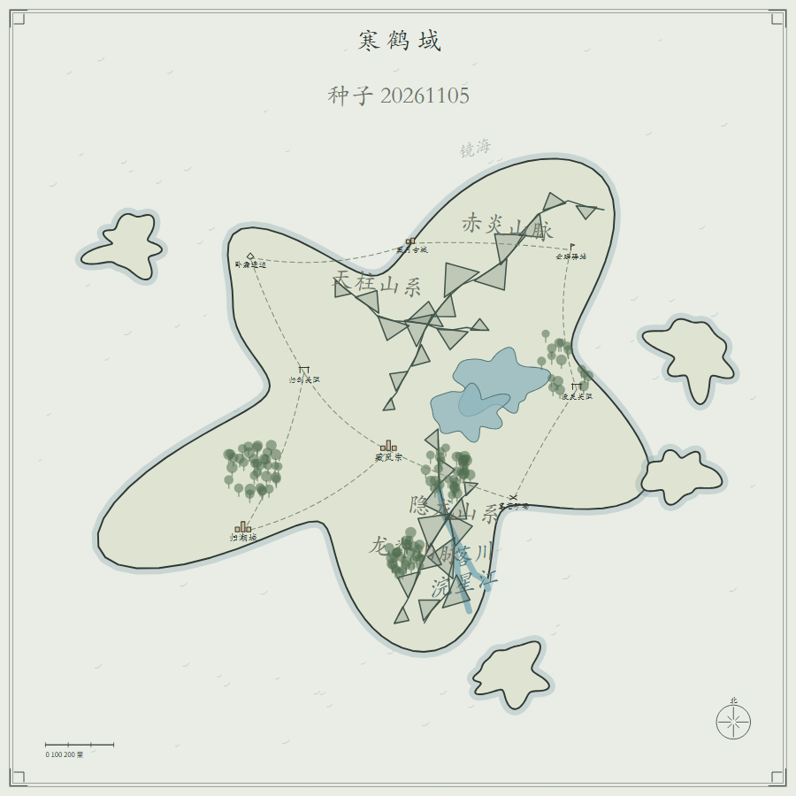
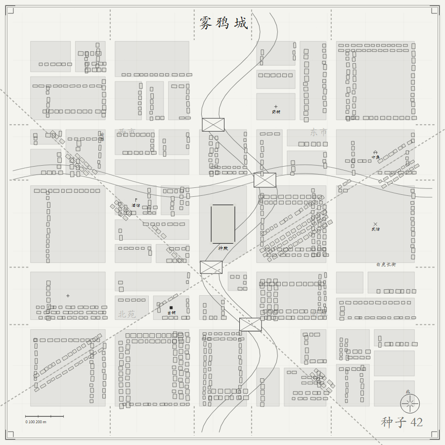
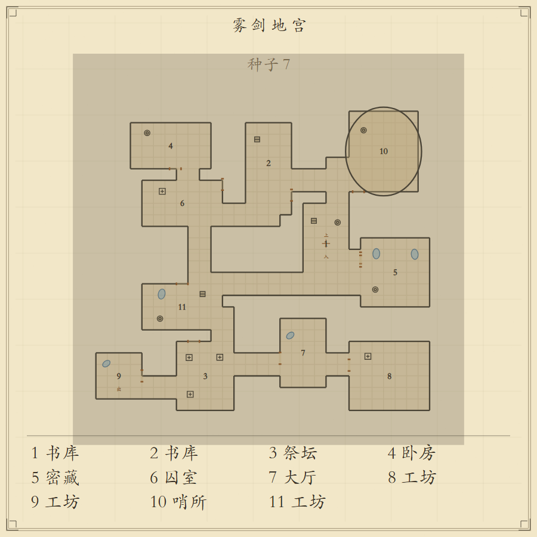
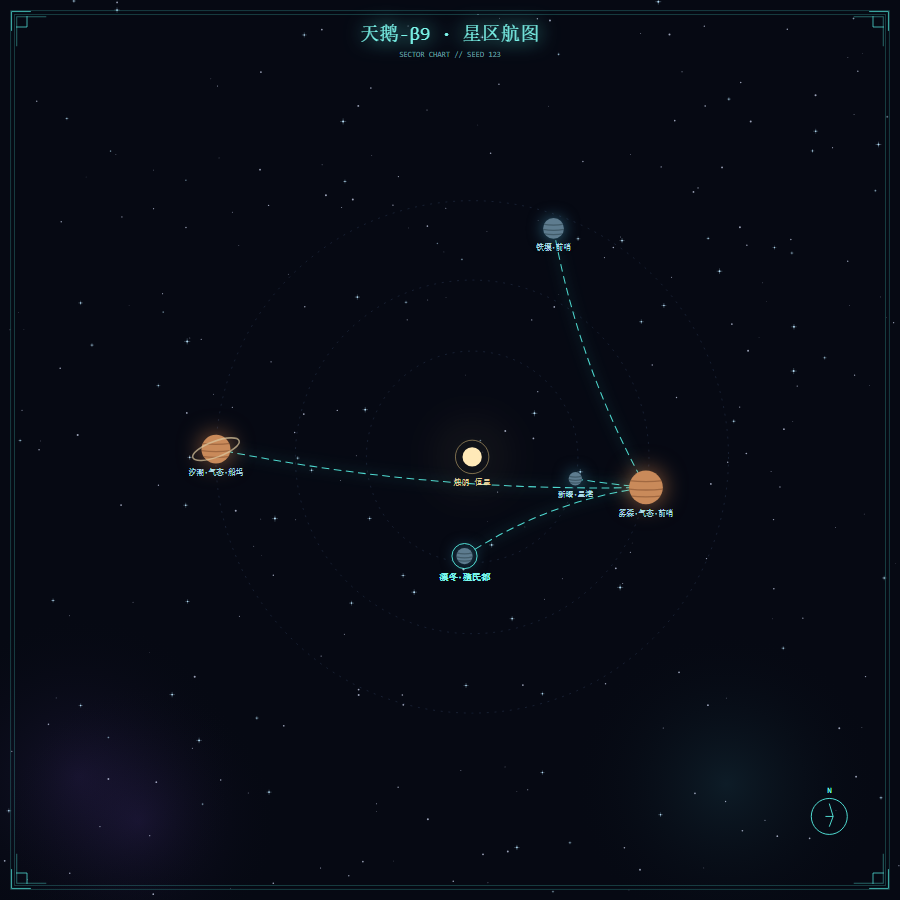

# 大千境 · 奇幻地图生成 Skill

一句话生成**中文奇幻地图**，输出可缩放 SVG。5 种形态 × 5 种风格，同一种子完全可复现，零第三方依赖（只需要 Node.js）。

它是 [Agent Skill](https://docs.anthropic.com/en/docs/agents-and-tools/agent-skills) 形态的能力包，同时也是一个可直接用的命令行工具。生成内核抽取自微信小程序「大千境」v5.2。

| 修仙 · 大世界 | 水墨 · 城市 |
|---|---|
|  |  |

| 西幻 · 地牢 | 科幻 · 星图 |
|---|---|
|  |  |

## 快速开始

```bash
node scripts/generate.js --mode world --style xianxia --seed 临渊 --out 临渊域.svg
node scripts/generate.js --list     # 全部形态 / 风格
node scripts/generate.js --help     # 全部参数
```

产物是一张 1400×1400 viewBox 的 SVG：可无限放大、可在 Figma / Illustrator / Inkscape 里改字改色、可直接贴进网页或文档。加 `--json` 还能拿到完整地图数据（地块、道路、房间、节点、地名）供二次加工。

## 作为 Skill 安装

把整个目录放到 Agent 的 skill 目录即可：

- WorkBuddy：`~/.workbuddy/skills/daqianjing-map/`
- Claude Code / 其它支持 Agent Skills 的工具：`~/.claude/skills/daqianjing-map/`（或对应目录）

安装后，直接说「给我一张修仙风的大陆地图」「做张跑团地牢图」之类的话就会触发。触发条件、工作流与非目标写在 [SKILL.md](SKILL.md)。

## 能力边界

| 能做 | 不做 |
|---|---|
| 城市 / 大世界 / 地牢 / 村庄 / 迷宫 五种形态 | 可交互界面（缩放、拖动、点选编辑） |
| 武侠 / 修仙 / 西幻 / 水墨 / 科幻全息 五种风格 | 生成微信小程序工程代码 |
| 中文地名、边框、比例尺、指北针、房间图例 | 直接输出 PNG（保持零依赖，SVG 自行转换） |
| 确定性复现、透明底、附带 JSON 数据 | 读取或修改已有图片 |

交互层依赖 `wx.*` 运行时，搬不进 Agent；本包封装的是**地图生成能力**。详见 [references/architecture.md](references/architecture.md)。

## 目录

```
SKILL.md                 触发条件、工作流、非目标
scripts/core.js          纯生成 + 绘制内核（2701 行）
scripts/svg_canvas.js    Canvas2D → SVG 记录器
scripts/generate.js      CLI
scripts/selftest.js      5×5 矩阵自测
references/              参数字典、架构说明
tools/extract_core.js    从小程序重新抽取内核
examples/                样例 SVG + PNG 预览
```

## 参数

完整字典见 [references/parameters.md](references/parameters.md)。常用：

```bash
# 同一世界换画法（地形地名不变）
node scripts/generate.js --seed 20261105 --style xianxia --out a.svg
node scripts/generate.js --seed 20261105 --style ink     --out b.svg

# 城市：水墨风、无河、中心神殿
node scripts/generate.js --mode city --style ink --seed 42 --no-river --center temple

# 跑团地牢：带房间数据
node scripts/generate.js --mode dungeon --style fantasy --seed 7 --json
```

## 验收

```bash
node scripts/selftest.js
```

跑 5 形态 × 5 风格矩阵，校验 SVG 合法性、确定性、透明底、JSON 回读与极端参数防呆。CI 在每次 push 时执行（Node 18 / 20 / 22）。

## 与上游小程序的关系

`scripts/core.js` 由 `tools/extract_core.js` 从小程序 `pages/index/index.js` 的「页面」分界标记之前自动抽取，改动上游后重跑一次即可同步。抽取时会校验内核不含 `wx.*`。历史上曾在此修正一处参数错位（`drawIcon` 多传一个参数导致大世界据点图标从未画出）；**该缺陷已于 2026-11-09 在小程序本体 `index.js` 同步修复**，抽取脚本保留对旧版源码的兼容兜底。细节见架构文档。**小程序本体不在此仓库内。**

## 许可证

[MIT](LICENSE)。允许商用与二次分发。若打算把它作为付费数字商品独占销售，需要换成限制更严的许可证 —— 请自行评估，别默认 MIT 能保护独占性。
